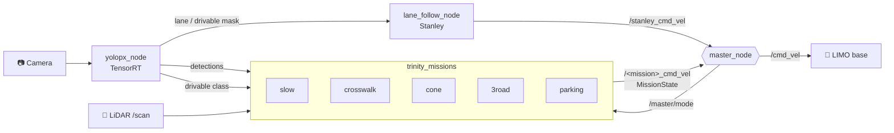
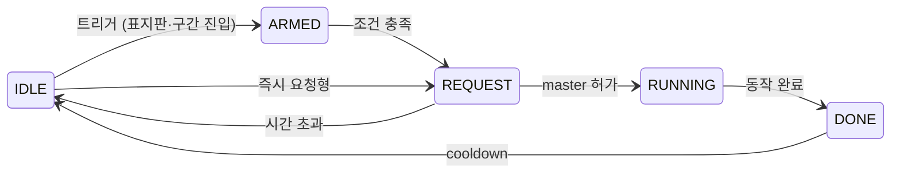
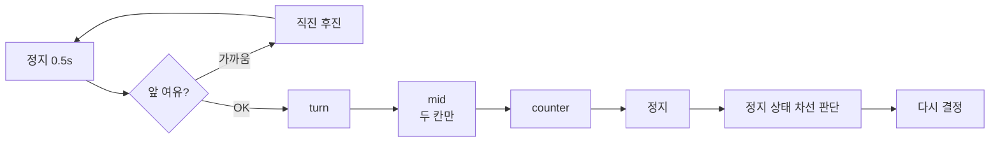

<div align="center">

# 🚗 Trinity — LIMO 자율주행

**AgileX LIMO 위에서 카메라 + 2D 라이다로 대회 맵을 완주하는 ROS 2 자율주행 스택**


`차선 주행` · `감속 구간` · `횡단보도 신호` · `라바콘 회피` · `3차선 장애물 회피` · `주차`

</div>

---

## ✨ 한눈에 보기

| | |
|---|---|
| 🧠 **인식** | YOLOPX 멀티태스크 (차선 · 주행가능영역(내 차선/왼쪽/오른쪽) · 객체 12종) → TensorRT FP16, 약 37 ms |
| 🛣️ **차선 주행** | BEV 변환 → 슬라이딩 윈도우 → 중심선 추적 → Stanley 제어 |
| 🎛️ **마스터** | 모드 하나만 `/cmd_vel` 을 낸다. 미션은 `REQUEST` 로 요청, 마스터가 허가·중재·타임아웃 |
| 🧩 **미션** | 공통 베이스(`MissionNode`) 위에 미션별 노드 5개, 파라미터는 전부 YAML |

---

## 🗺️ 시스템 구조



### 미션 상태 머신



- **preempt** `crosswalk>slow` — 횡단보도가 감속 구간을 끊고 들어감
- **block** `3road>cone` — 3차선 구간 안에서는 콘 모드 금지
- **mission_max_sec** — 미션별 안전 시간 제한, 넘으면 normal 복귀

---

## 📦 패키지

| 패키지 | 역할 |
|---|---|
| [`yolopx_line`](src/yolopx_line) | YOLOPX TensorRT 추론, 마스크/검출 퍼블리시, ONNX·엔진 빌드 툴 |
| [`mission`](src/mission) | 차선 주행 (`lane_follow_node`: BEV, 차선 추적, Stanley) |
| [`trinity_missions`](src/trinity_missions) | 미션 노드들 + 공통 베이스 `mission_base.py` |
| [`master`](src/master) | 모드 중재, `/cmd_vel` 단일 출력, 콘솔 대시보드, 전체 launch |
| [`trinity_msgs`](src/trinity_msgs) | `MasterMode`, `MissionState` 메시지 |

---

## 🏁 미션

| 모드 | 트리거 | 동작 |
|---|---|---|
| 🐢 **slow** | `sign_slow` / `zigzag` | 일정 시간 감속 주행 |
| 🚦 **crosswalk** | `sign_pedestrian` | 횡단보도 앞 정지 → 신호 기록 → 초록이면 출발 |
| 🔶 **cone** | 라이다 콘 감지 | 콘 사이 통로 경로 추종 (콘 반경 여유 보정) |
| 🛣️ **3road** | 3차선 구간 진입 (2차선에서) | 차선별 장애물 판단 → 차선 변경 / 복귀 |
| 🅿️ **parking** | `sign_parking` + 정지선 | 직진 → 최대 조향 → 정지 30 s → normal |

<details>
<summary><b>🛣️ 3road 알고리즘 자세히</b></summary>

<br/>

**차선 판단** — 차선과 평행할 때만 (near·ahead yaw ≤ 10°), 3프레임 연속

| 보이는 옆 차선 | 내 차선 |
|---|---|
| 왼쪽 + 오른쪽 | 2 |
| 오른쪽만 | 1 |
| 왼쪽만 | 3 |

**결정** — (현재 차선, home, 막힌 차선) 으로 매 스캔 판단

- 내 차선이 막힘 → home 에 가장 가까운 빈 차선으로 회피
  - 한 칸: 앞 장애물 `< 0.7 m` · 두 칸: `< 1.0 m`
  - 두 칸인데 **가운데 차선이 막혀 있으면** 0.7 m 까지 직진 (그 사이 비면 한 칸)
- 막히지 않았고 home 이 아니며 가는 길이 비었음 → home 복귀
- 표지판 `sign_A` → home 1, `sign_B` → home 3

**공통 차선 변경 루틴**



- turn/counter 시간은 차선 중심 오프셋으로 편향 보정
- **guard** (라이다 0.13 m) — 최후 수단: 후진 → 평행 맞추기 → 재판단
- 디버그: `rqt_image_view /three_road/debug`

</details>

---

## 🚀 실행

### 빌드

```bash
cd ~/trinity_ws
source /opt/ros/humble/setup.bash          # 꼭 먼저!
colcon build --symlink-install
source install/setup.bash
```

> [!NOTE]
> `--symlink-install` 이라 Python 코드와 YAML 수정은 **재빌드 없이** launch 재시작만으로 반영됩니다.

### 모델

`*.engine`, `*.onnx`, `*.pth` 는 용량 때문에 저장소에 없습니다. `yolopx_line/tools/export_onnx.py` 로 ONNX 를 만들고 Jetson 에서 `trtexec` 로 FP16 엔진을 빌드해 `src/yolopx_line/models/` 에 둡니다.

### 전체 실행

```bash
ros2 launch master master.launch.py              # 대시보드만 출력
ros2 launch master master.launch.py quiet:=false # 모든 노드 로그
```

### 수동 모드 전환 (테스트)

```bash
ros2 topic pub --once /master/set_mode std_msgs/String "data: parking"
#   normal / slow / crosswalk / 3road / cone / parking
```

---

## ⚙️ 주요 파라미터

| 파일 | 내용 |
|---|---|
| [`master.yaml`](src/master/config/master.yaml) | 미션 목록, 우선순위 규칙, 시간 제한, 모니터 토픽 |
| [`mission.yaml`](src/mission/config/mission.yaml) | BEV 기하, 슬라이딩 윈도우, Stanley 게인·속도 |
| [`yolopx.yaml`](src/yolopx_line/config/yolopx.yaml) | 엔진 경로, 클래스, 임계값 |
| [`three_road.yaml`](src/trinity_missions/config/three_road.yaml) | 회피 거리, 차선 변경 시간(실측), guard |
| [`cone.yaml`](src/trinity_missions/config/cone.yaml) · [`parking.yaml`](src/trinity_missions/config/parking.yaml) · [`slow.yaml`](src/trinity_missions/config/slow.yaml) · [`crosswalk.yaml`](src/trinity_missions/config/crosswalk.yaml) | 미션별 트리거·동작 |

---

## 🔧 하드웨어

| 항목 | 사양 |
|---|---|
| 차량 | AgileX LIMO (Ackermann, wheelbase 0.2 m, 최대 조향 0.983 rad) |
| 컴퓨터 | Jetson Orin Nano (15 W) |
| 카메라 | 전방 RGB (640×480) |
| 라이다 | 2D LiDAR (`base_link` 기준 x 0.103 m) |

<div align="center">
<sub>Built with ROS 2 Humble · Team Trinity</sub>
</div>
